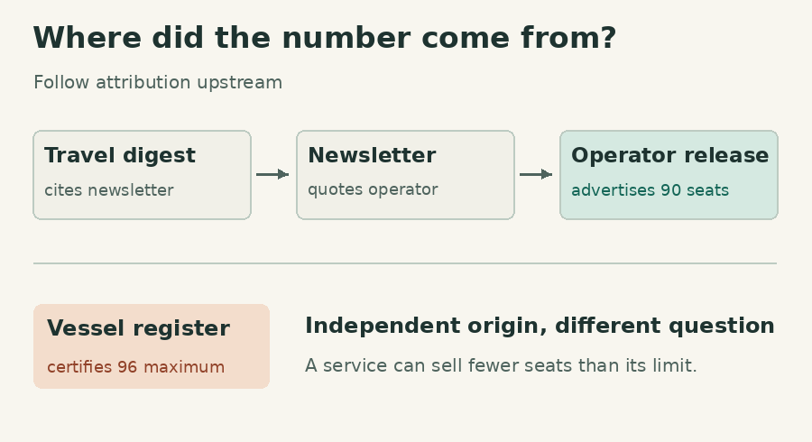

Parallel research workers reduce search time and cover more queries. They do not automatically produce independent evidence. If two workers read derivatives of the same announcement, their agreement has a shared cause. A synthesis step that counts worker votes or URLs will assign excess weight to a single observation.

I attach provenance to **a claim in a passage**. An entire document is too coarse: the same report can repeat one figure from a press release and independently measure another. A useful claim key includes the subject, predicate, value, unit, scope and effective date. A support edge connects a source passage to that claim. A derivation edge records that the passage attributes it to another source. The W3C PROV model supplies vocabulary for derivation and primary sources. [W3C PROV-O](https://www.w3.org/TR/prov-o/)



## Collapse known derivations before synthesizing

The digest quotes a newsletter, which quotes the operator. Following those two edges yields one known origin for the advertised capacity. The vessel register is a distinct origin for *certified maximum capacity*. Both numbers can be correct because the predicates differ. Grouping by vessel ID alone would convert a difference in meaning into an apparent numerical conflict.

```python
# Edges are specific to the passage supporting this claim.
parents = {"digest": ["newsletter"], "newsletter": ["operator"],
           "operator": [], "register": []}

def roots(node, path=()):
    if node in path:
        raise ValueError("cyclic attribution")
    upstream = parents[node]
    if not upstream:
        return {node}
    return set().union(*(roots(p, path + (node,)) for p in upstream))

print(roots("digest") == roots("newsletter") == {"operator"})
# True
```

In this fixture an empty parent list marks a **verified origin**. Production data needs a separate state for “attribution unknown.” Treating an unknown source as a fresh root would manufacture independence. A derivation cycle also leaves the original observation unknown. The code rejects it instead of guessing.

## What a worker should return to its coordinator

I want the extracted claim, quoted evidence, locator, document revision, attribution and unresolved qualifiers. A coordinator can merge compatible claim keys, preserve their known origins and expose disagreements with their scope. A new URL or a paraphrase can broaden coverage without changing the origin count. A genuinely independent measurement deserves its own record even when it matches the advertised figure exactly.

A good test changes one property at a time. Syndicate a passage under a new URL and check that support still has one known origin. Then add an independent record with a different predicate and check that both claims survive. These tests exercise the coordinator after retrieval. Improving individual search workers would not fix a merger that discards the distinction. [Anthropic's multi-agent research system](https://www.anthropic.com/research/multi-agent-research-system)
