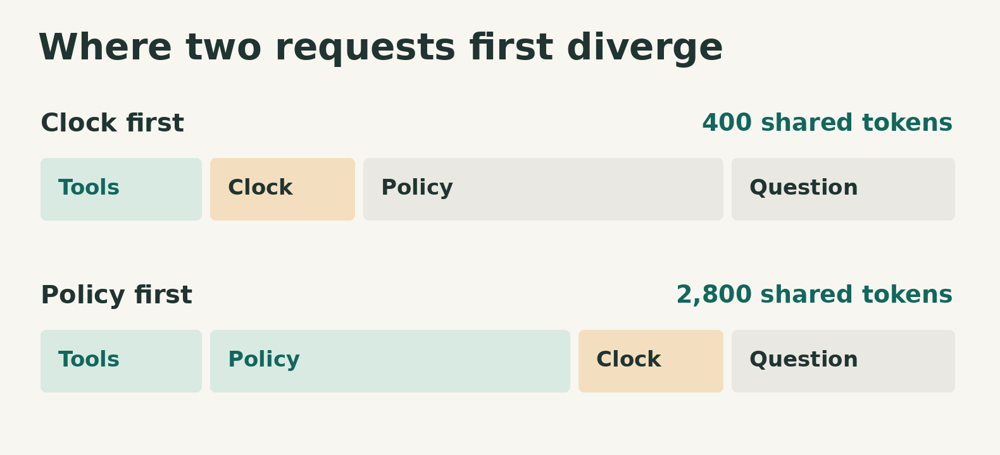

During prefill, a language model processes the input prefix before decoding an answer. Prompt caching allows a service to reuse work associated with an eligible prefix on later requests. An identical paragraph appearing after an earlier difference cannot extend that same prefix match. This is why the serialization order of tools, instructions, retrieved content and per-request metadata matters even when the visible user question stays the same.



In this fixture, 400 tokens represent stable tool definitions and 2,400 represent a stable policy. Moving a varying timestamp behind the policy increases the common prefix from 400 to 2,800 tokens. Those numbers bound what could be reused. The provider's supported block boundaries, model, minimum length, TTL and cache availability determine what actually receives a cache read. Claude documents creation and read usage separately. [Prompt caching documentation](https://platform.claude.com/docs/en/build-with-claude/prompt-caching)

## Derive the reuse threshold

Let `P` be the eligible prefix length. In units where ordinary input processing costs one per token, let `w` be the creation price and `r` the read price. Across `n` requests, one creation followed by `n−1` successful reads costs `P × (w + (n−1)r)`. Ordinary processing costs `Pn`. For `r < 1`, caching is cheaper when `n > (w−r)/(1−r)`. The inequality assumes the entry stays eligible and warm throughout.

With illustrative prices `w = 1.25` and `r = 0.10`, two requests cost `1.35P` instead of `2P`. A single request pays a premium of `0.25P`. A large one-off input can therefore have less caching value than a shorter prefix reused frequently before expiry.

<details>
<summary>Reproduce the common-prefix counts</summary>

```python
def common_prefix(left, right):
    for i, (a, b) in enumerate(zip(left, right)):
        if a != b:
            return i
    return min(len(left), len(right))

tools = ["T"] * 400
policy = ["P"] * 2400
old, new = ["clock-1"], ["clock-2"]
q1, q2 = ["order-status"], ["return-window"]

early = common_prefix(tools + old + policy + q1, tools + new + policy + q2)
late = common_prefix(tools + policy + old + q1, tools + policy + new + q2)
print(early, late)
# 400 2800
```

</details>

## Measure reuse without concealing stale data

For comparable request pairs, record model version, creation tokens, read tokens and time to first token. Group by time since last reuse and input size. An aggregate request hit rate weights a tiny reused prefix the same as a long one. A token-weighted rate and latency distribution give a more useful picture. Output generation still takes place, so a prefill improvement may have little effect on total latency for a long response.

I keep durable policy text early and freshly fetched account state after it. A regression test updates the account between two requests, then checks both the cache-read counter and the second answer. A cache hit with a fresh answer is expected. If a balance stays unchanged after the source update, investigate retrieval or an application-level answer cache before attributing the result to prefix reuse.
