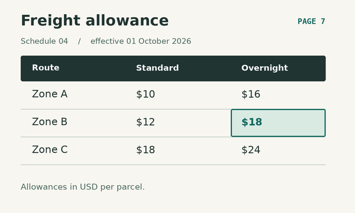

A document QA system can generate the correct scalar value while citing the wrong evidence. Table answers make this especially easy: a value may appear in several rows, and its meaning depends on the row header, column header and unit. I therefore treat answer generation and evidence localization as separate outputs with separate tests.

In the example, `$18` occurs twice. Selecting the right document, page and string still leaves two candidate cells. The distinguishing information is the intersection of *Zone B* and *Overnight*. A crop containing only the number loses the context needed for verification.



## From retrieval to a stable citation

Coarse-to-fine retrieval narrows a multi-page document to candidate pages, then allocates higher-resolution reading to the relevant regions. This reduces the amount of visual material consumed in detail. It also creates a hard recall boundary: an accurate reader cannot ground an answer on a page excluded by the first stage. Keep the candidate page IDs and the final evidence region so those failures can be diagnosed separately. [Doc-V*, ACL 2026](https://aclanthology.org/2026.acl-long.2129/)

My citation record contains a document ID and immutable revision, a zero-based page index, a coordinate-space definition and four cell edges. The viewer can highlight a tight box while displaying enough of the surrounding table to preserve the headers. Replacing an edition with a new revision requires resolving or recomputing its citation. A page number in the current edition has no durable relationship to the earlier evidence.

## Project the rectangle into the viewer

This fixture uses an upright 600 × 360 raster with a top-left origin. Normalize each horizontal edge by page width and each vertical edge by page height. Multiply by the displayed page dimensions at render time.

```python
from math import isclose

page = (600, 360)
cell = (390, 184, 550, 231)
normalized = tuple(edge / page[i % 2] for i, edge in enumerate(cell))

def project(box, width, height):
    scale = (width, height, width, height)
    return tuple(round(edge * factor) for edge, factor in zip(box, scale))

assert project(normalized, 300, 180) == (195, 92, 275, 116)
assert project(normalized, *page) == cell
assert isclose(normalized[0], 0.65)
print(project(normalized, 900, 540))
# (585, 276, 825, 346)
```

For a 300 × 180 display, the left edge projects to 195 CSS pixels. Add a 12-pixel viewer gutter and it sits at 207 pixels from the viewer's left edge. Cropped or rotated PDFs require an explicit page-to-raster transform before normalization. Likewise, a high-DPI canvas can have different backing-store and CSS dimensions. Apply the transform in the coordinate system of the overlay.

## Evaluate the two failure surfaces

For retrieval, measure whether a labeled evidence page appears in the candidate set. For grounding, condition on that page being present and score the selected cell or overlap with an annotated region. A useful counterfactual edits only the target cell from $18 to $21, leaving the distractor untouched. The answer should change while the citation continues to identify the same row and column. If only the answer changes, inspect region extraction or the viewer transform before retuning the language model.
