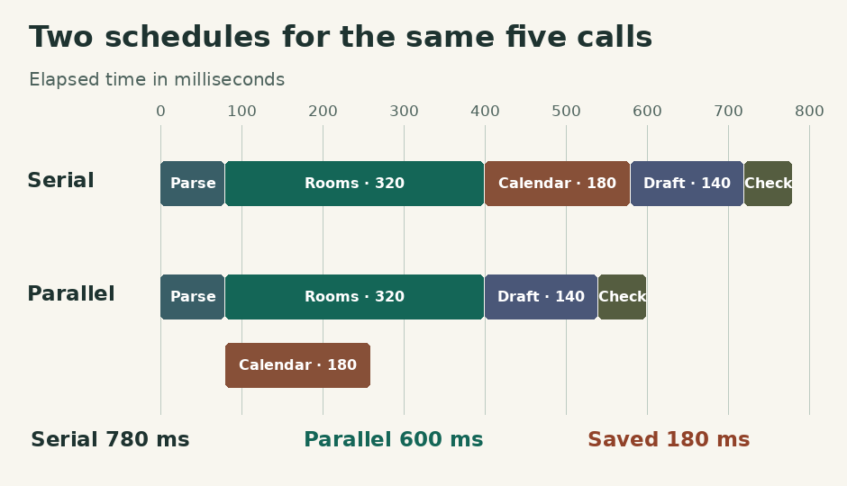

A model can emit several tool calls in one response. Wall-clock speedup depends on which calls can start together and which results the next decision consumes. I represent a turn as a directed acyclic graph. Each node has a duration. An edge means the child requires a parent's output or must wait for its effect to complete.

With unlimited execution slots, the earliest finish of node `v` equals its duration plus the maximum finish time of its parents. A root starts at zero. The finish time of the final required node is the critical-path length. With limited workers, rate limits or resource conflicts, that length becomes a lower bound.



In the illustrated schedule, the serial path takes 780 ms. Overlapping a 320 ms room lookup and a 180 ms calendar lookup gives `80 + max(320,180) + 140 + 60 = 600 ms`. The predicted speedup is 1.30×. The faster lookup has 140 ms of slack: shortening it alone cannot reduce the join time.

```python
def finishes(room_ms, calendar_ms):
    steps = [
        ("parse", 80, []),
        ("room", room_ms, ["parse"]),
        ("calendar", calendar_ms, ["parse"]),
        ("draft", 140, ["room", "calendar"]),
        ("check", 60, ["draft"]),
    ]
    end = {}
    for name, duration, parents in steps:
        end[name] = max((end[parent] for parent in parents), default=0) + duration
    return end

print(finishes(320, 180)["check"], finishes(320, 450)["check"])
# 600 730
```

At 450 ms the calendar becomes the slower sibling and total latency rises to 730 ms. A profiler ranking tools by cumulative duration does not expose this change of critical path. I record when each call becomes ready, when it actually starts, when its result arrives, and when the dependent model turn begins. These timestamps distinguish queue delay, execution time and a join waiting on another branch.

## Conditions for safe fan-out

Read-only calls can overlap when their arguments are already resolved and the application accepts the resulting observation times. If one call determines the timezone needed to construct the other's request, there is a data dependency even if the transport accepts both requests immediately. Overlapping writes additionally require compatible effects, resource ordering or an explicit conflict policy.

In Python, creating a coroutine object alone does not schedule concurrent work. An `asyncio.TaskGroup` schedules child tasks and waits when leaving the group. A non-cancellation failure in one task normally cancels unfinished siblings. This suits an all-or-nothing join. An application that can return partial results should define which failures are ordinary branch outcomes and retain completed results accordingly. Cancellation of a local task also does not roll back a remote operation already accepted by a service. [Python task groups](https://docs.python.org/3/library/asyncio-task.html#task-groups)

For a production decision I compare end-to-end latency under equal load, including provider quotas and time waiting for a worker. Two independent requests behind a single concurrency slot serialize in practice. The graph identifies the overlap worth pursuing; the trace establishes how much of it the deployed service can deliver.
