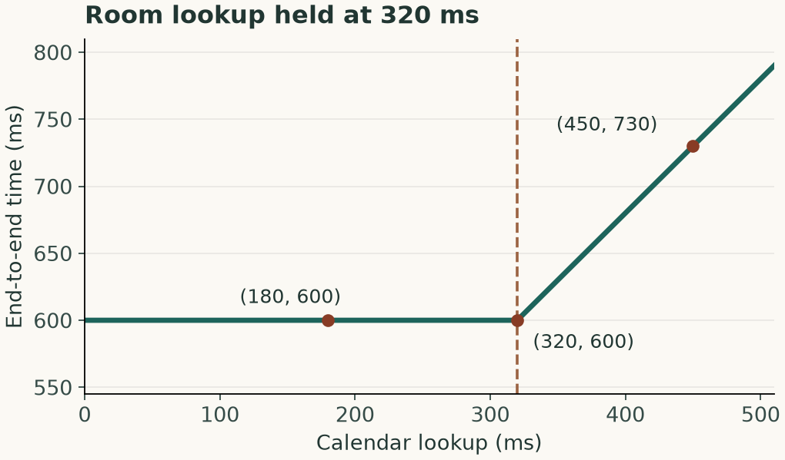

A venue assistant needs both a room that fits and a free slot on the organizer's calendar. Someone suggests making the two tool calls in parallel. The room lookup usually takes longer, so the suggestion sounds right. Before changing the scheduler I would ask a more precise question: at what time does the assistant have everything it needs to start drafting the answer? That question makes the benefit calculable and exposes cases where the change buys nothing.

A model can emit several tool calls in one response. Wall-clock speedup depends on which calls can start together and which results the next decision consumes. I represent a turn as a directed acyclic graph. Each node has a duration. An edge means the child requires a parent's output or must wait for its effect to complete.

With unlimited execution slots, the earliest finish of node `v` equals its duration plus the maximum finish time of its parents. A root starts at zero. The finish time of the final required node is the critical-path length. With limited workers, rate limits or resource conflicts, that length becomes a lower bound.


## Walk the clock from the user's request

At time zero the request arrives. Parsing occupies the first 80 ms and determines the room size and date, so neither lookup has usable arguments before that point. Both can start at 80. The calendar finishes at 260, the room search at 400. Drafting consumes 140 ms starting at 400, and a final check consumes 60. The calendar response sits ready for 140 ms. That waiting time belongs to the join, even though a trace viewer may show the calendar call as green long before the user sees a result.

Now add a worker constraint. Suppose both tools call one upstream service through a single available slot. Dispatching two asynchronous tasks still leaves one waiting. With the same service durations the lookups consume 500 ms on that slot and the turn finishes at 780 ms. If the implementation reports only “time inside the tool,” neither timing changes, while the user loses the entire predicted speedup. This is why I keep the time a call became eligible to run.

In the illustrated schedule, the serial path takes 780 ms. Overlapping a 320 ms room lookup and a 180 ms calendar lookup gives `80 + max(320,180) + 140 + 60 = 600 ms`. The predicted speedup is 1.30×. The faster lookup has 140 ms of slack: shortening it alone cannot reduce the join time.

```python
def finishes(room_ms, calendar_ms):
    steps = [
        ("parse", 80, []),
        ("room", room_ms, ["parse"]),
        ("calendar", calendar_ms, ["parse"]),
        ("draft", 140, ["room", "calendar"]),
        ("check", 60, ["draft"]),
    ]
    end = {}
    for name, duration, parents in steps:
        end[name] = max((end[parent] for parent in parents), default=0) + duration
    return end

print(finishes(320, 180)["check"], finishes(320, 450)["check"])
# 600 730
```

At 450 ms the calendar becomes the slower sibling and total latency rises to 730 ms. A profiler ranking tools by cumulative duration does not expose this change of critical path. I record when each call becomes ready, when it actually starts, when its result arrives, and when the dependent model turn begins. These timestamps distinguish queue delay, execution time and a join waiting on another branch.

### A faster tool can leave the turn exactly as slow

With the original inputs, cut calendar service time from 180 to 90 ms. Its result now lands at 170, yet drafting still starts at 400. Cut the room lookup by the same 90 ms instead and the turn ends at 510. Once the room and calendar durations meet, further improvements to only one sibling stop helping. The priority of an optimization depends on its position in the graph as well as its duration.



Averages can obscure the same effect across many turns. Consider two equally likely schedules. In the first the room takes 500 ms and the calendar 100; in the second those times reverse. Each tool averages 300 ms. The join waits 500 ms on *every* turn. Taking the maximum of the two averages predicts 300 and misses 200 ms. Compute the join duration for each recorded turn and then summarize those durations. That also preserves correlations caused by a shared busy upstream service.

## Conditions for safe fan-out

Read-only calls can overlap when their arguments are already resolved and the application accepts the resulting observation times. If one call determines the timezone needed to construct the other's request, there is a data dependency even if the transport accepts both requests immediately. Overlapping writes additionally require compatible effects, resource ordering or an explicit conflict policy.

In Python, creating a coroutine object alone does not schedule concurrent work. An `asyncio.TaskGroup` schedules child tasks and waits when leaving the group. A non-cancellation failure in one task normally cancels unfinished siblings. This suits an all-or-nothing join. An application that can return partial results should define which failures are ordinary branch outcomes and retain completed results accordingly. Cancellation of a local task also does not roll back a remote operation already accepted by a service. [Python task groups](https://docs.python.org/3/library/asyncio-task.html#task-groups)

For a production decision I compare end-to-end latency under equal load, including provider quotas and time waiting for a worker. Two independent requests behind a single concurrency slot serialize in practice. The graph identifies the overlap worth pursuing; the trace establishes how much of it the deployed service can deliver.

## Set the join policy before setting the timeout

The product can sometimes change the graph. If the UI merely promises to show candidate rooms, it might render the rooms while marking availability as still being checked. If it promises that every result is bookable at the requested time, the calendar is a required input. In the first product a slow calendar affects time to a complete answer; in the second it also affects time to the first truthful result. I would measure both events explicitly before celebrating a latency gain.

My smallest regression trace contains one independent pair and one dependent pair. The independent lookups should start together when two slots are available. A calendar call whose arguments depend on the room's timezone should start only after the room response. A scheduler that blindly fans out both pairs can win the benchmark by answering a different question. Checking the arguments and resulting schedule makes the speedup interpretable.
