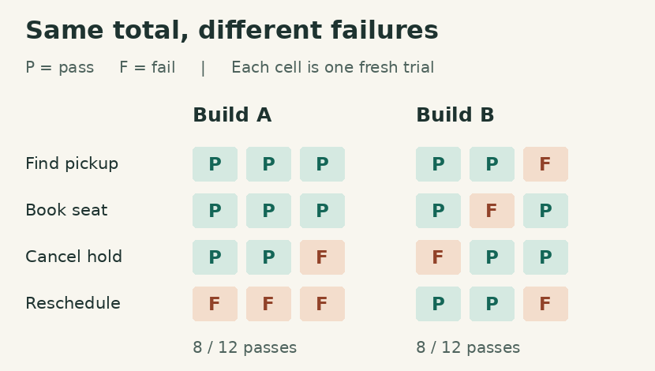

If I tell you a booking agent completed eight out of twelve trials, would you try the failed bookings a second time or build support for a missing operation? Either decision could make sense. What I left out is whether the four failures belonged to the same few tasks. The grid below records that information with one row per task and one cell per fresh attempt. Read across a row before reading the total.

Two agent builds can have the same pass rate and very different engineering problems. A pooled rate estimates how often a randomly selected observed trial passed. It discards which trials belonged to the same task. I keep the task-by-trial matrix because a missing capability and intermittent execution failures call for different follow-up experiments.



Both illustrative builds pass 8 of 12 trials. Build A has per-task counts of 3, 3, 2 and 0. Build B has 2 on every task. With three observed attempts per task, A demonstrates at least one success on three of four tasks and passes every attempt on two. B demonstrates all four tasks and passes every attempt on none. The distinction between occasional capability and consistent completion motivates repeated-trial evaluation in τ-bench. [τ-bench](https://arxiv.org/abs/2406.12045)

Build A's last row is the one that would draw my attention in a review. Three misses on the same task might mean its tool is unavailable, its instruction is ambiguous or its grader is wrong. The row identifies a good place to look; it cannot identify the cause. Build B has a pass for every task, which makes a single permanently missing operation a less convincing explanation for its pattern. A passing and failing trace for the same task would be a better next comparison there.

## What two chances buy in the recorded grid

Take one of B's rows, with two passes and one failure. If we choose two distinct recorded attempts, there are three possible pairs. One contains two passes. The other two each contain a pass and the failure. Every pair therefore has *at least one* pass, while only one pair in three is *all* passes. Those phrases answer different product questions. A candidate generator with a reliable verifier might make use of either good result. An assistant expected to repeat a correct action consistently has to care about both attempts.

For A, the two perfect rows each contribute one to both measures. The two-pass row contributes one and one third, and the zero-pass row contributes zero to both. Averaging equally across the four tasks gives 0.75 for at least one success and 7/12 for two successes. Both builds had the same single-attempt pooled score. Keeping the rows made it possible to calculate something genuinely different.

## Use the task as the unit of aggregation

For a task with `c` successes among `n` recorded trials, choose `k` distinct trials uniformly. There are `C(n,k)` possible groups. Exactly `C(n−c,k)` contain no successes, and `C(c,k)` contain only successes. This yields an estimator for at-least-one success and one for all-success. Compute each within a task and then average over tasks according to the intended workload.

```python
from math import comb
from statistics import mean

def measures(successes, n, k):
    if not 0 <= successes <= n or not 1 <= k <= n:
        raise ValueError("invalid trial counts")
    groups = comb(n, k)
    any_pass = 1 - comb(n - successes, k) / groups
    all_pass = comb(successes, k) / groups
    return any_pass, all_pass

for counts in ([3, 3, 2, 0], [2, 2, 2, 2]):
    pairs = [measures(c, 3, 3) for c in counts]
    print(mean(p[0] for p in pairs), mean(p[1] for p in pairs))
# 0.75 0.5
# 1.0 0.0
```

The estimates describe the recorded groups. Extrapolating them to future runs requires representative tasks, fresh state and comparable conditions. Cubing the pooled `8/12` silently treats heterogeneous tasks as though they shared one independent success probability. Additional attempts on a few familiar tasks cannot establish coverage of new task types.

A further assumption hides inside the word “retry.” The combinatorial calculation draws attempts from fresh trials for the same task. A real retry may inherit a half-created reservation, a previous answer in context or a customer's frustrated correction. It may also cost money to determine which attempt succeeded. To evaluate a retrying product I would run the actual retry policy, including the verifier and state carried forward. The grid remains a good capability diagnostic even when that policy is unavailable.

Weighting is another product choice. Four equal rows give a rare multistep task the same weight as an everyday lookup. If 90% of customer traffic is the lookup, an equal-task average and a traffic-weighted score can legitimately diverge. I would publish the equal-task grid and, if credible workload weights exist, the weighted estimate alongside it. That lets someone see whether a change improved an important rare capability or the experience of a typical request.

## Decide which uncertainty to reduce

For A, investigate the consistently failing row first. Check whether its requested operation exists and whether the grader accepts valid outcomes. For B, align a passing and failing trace for the same task and inspect the first diverging action or observation. To compare builds, use the same task set and preserve per-task pairing when estimating uncertainty. A task-level resample answers a different question from resampling individual turns.

I would report all three quantities with their denominators. A retryable offline workflow may benefit from several attempts if a reliable verifier selects a successful result. A user-facing booking flow needs to work on the attempt the user actually makes. The metric follows that product constraint. [Guide to agent evaluation metrics](https://www.anthropic.com/research/demystifying-evals-for-ai-agents)

Three trials are enough to illustrate the arithmetic and a poor basis for declaring a capability impossible. A row with zero passes is a question to investigate, and a row with three passes is a small amount of evidence for consistency. Keeping the raw grid beside the headline is inexpensive. It lets the next engineer ask a better question when trial thirteen arrives: did we learn something about a new task, or just reduce uncertainty about an old one?
