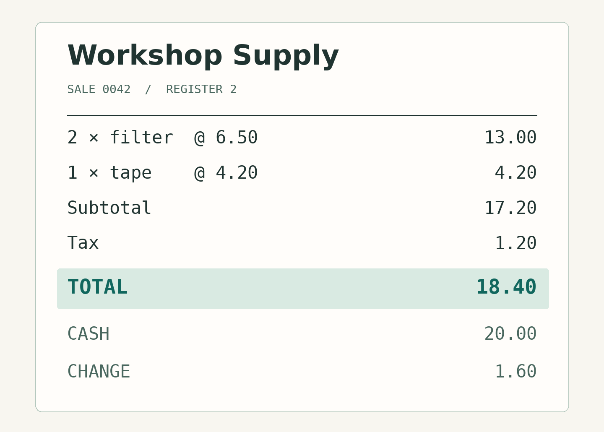

A schema tells a document extractor how to represent a record. It can require a currency, restrict an amount to a decimal string and reject missing fields. It cannot establish that a recognized number came from the correct line of the document. I keep a source region and its nearby label alongside each extracted value so this semantic error remains inspectable.



Here the OCR text includes both a total of 18.40 and cash tendered of 20.00. A model can transcribe every digit correctly and still assign `20.00` to `total`. Improving character recognition on this document would leave the error intact. Layout-aware parsing is useful because it retains enough region structure to make field attribution testable. [PaddleOCR-VL pipeline](https://www.paddleocr.ai/main/en/version3.x/pipeline_usage/PaddleOCR-VL.html)

## Two independent consistency checks

For this USD receipt, two filters at $6.50 and tape at $4.20 give a $17.20 subtotal. Tax adds $1.20. The settlement record independently gives `cash tendered − change = 20.00 − 1.60 = 18.40`. These constraints share the extracted total but draw on different observed fields. Agreement between them is stronger evidence than repeating the total from the same crop twice.

```python
from decimal import Decimal

def cents(raw):
    amount = Decimal(raw) * 100
    if not amount.is_finite() or amount != amount.to_integral_value():
        raise ValueError("expected an amount in whole cents")
    return int(amount)

items = [(2, "6.50"), (1, "4.20")]
subtotal = sum(qty * cents(unit) for qty, unit in items)

def review(total, tendered, change, source_label):
    flags = []
    if subtotal + cents("1.20") != cents(total):
        flags.append("sale_mismatch")
    if cents(tendered) - cents(change) != cents(total):
        flags.append("settlement_mismatch")
    if source_label != "TOTAL":
        flags.append("inspect_total_region")
    return flags

assert review("18.40", "20.00", "1.60", "TOTAL") == []
print(review("20.00", "20.00", "1.60", "CASH"))
# ['sale_mismatch', 'settlement_mismatch', 'inspect_total_region']
```

The validator includes a label check as well as both arithmetic checks. Decimal parsing and integer cents avoid binary floating-point artifacts for this currency. The assumptions matter: a tax-inclusive price, a discount allocated per line, multiple tenders, or a currency with a different minor-unit convention needs a corresponding rule. A missing cash line makes the settlement rule unavailable. Treating it as a numeric zero invents data.

## What reconciliation cannot prove

On a fully paid card receipt, TOTAL and CARD can legitimately display the same number. A model that points to the CARD line may satisfy both equations. Conversely, a correct extraction can fail a naïve arithmetic check if the merchant rounds tax per item. I would route these outcomes differently: the first is an attribution question, the second may require a new accounting rule for the document family.

A review record should include the candidate field, source crop, normalized value, rule revision and reason for escalation. For evaluation, report field accuracy and automatic acceptance coverage, then count incorrect fields *among automatically accepted records*. Measuring only the accepted set rewards systems that quietly move the difficult documents into the manual queue.
