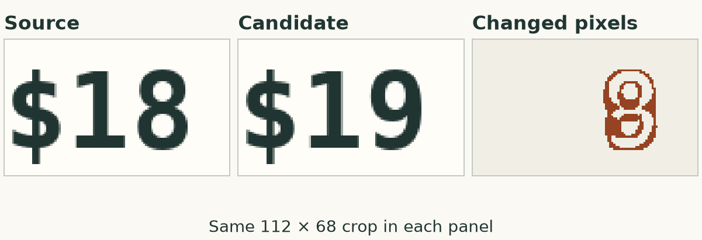

“Change the swatch from blue to coral. Keep the rest of the catalog card as supplied.” Before choosing an image metric, I would ask the catalog owner what would make the result unpublishable. A shade slightly warmer than expected might be negotiable. A price that changes from $18 to $19 is a different product listing. Both mistakes occupy pixels, but counting pixels gives them very different importance from counting business errors.

A localized image-edit instruction imposes two constraints. Pixels or semantics inside the target region should change in the requested way. Protected content elsewhere should remain valid. A whole-image similarity score mixes the two: copying the input achieves perfect preservation, while a successful color edit can hide a small but important change to text. GIE-Bench evaluates instruction following and preservation as distinct dimensions. [GIE-Bench](https://machinelearning.apple.com/research/gie-bench)


## Read the three cards as controls

Look at the left card and imagine returning it unchanged. Every protected pixel would be perfect. The requested edit would be missing. The middle card is the behavior we wanted: the target is coral and the protected material still describes the same item. The last card makes essentially the same color change and additionally alters one digit. If a single score ranks the unchanged and faulty cards highly, the score leaves the reviewer guessing which promise the model kept.

I translate the instruction into two questions a person could grade separately. Did the designated swatch acquire the requested color while keeping its intended shape? Can the item still be sold under the original price and description? In a graphic with a known palette, sampling the *interior* of the swatch gives a cheap color test. Sampling the boundary would mix foreground and antialiasing colors. A more open-ended instruction such as “make the finish look brushed” requires a different target check. The protected price can retain exactly the same check in either task.

## Compute the residual outside the edit mask

For registered RGB images, calculate absolute channel differences, set all pixels inside the permitted edit mask to zero, then count positions where the maximum channel difference exceeds a threshold. At a zero threshold this tests exact equality outside the mask. It is appropriate for the lossless, deliberately aligned fixtures below. Save both files beside the script and install Pillow. [Source PNG](/media/catalog-proof/source.png) · [Candidate PNG](/media/catalog-proof/candidate.png)

```python
from PIL import Image, ImageChops, ImageDraw

with Image.open("source.png") as a, Image.open("candidate.png") as b:
    source, candidate = a.convert("RGB"), b.convert("RGB")
assert source.size == candidate.size == (504, 562)
delta = ImageChops.difference(source, candidate)
ImageDraw.Draw(delta).rectangle((28, 26, 478, 366), fill="black")
# A pixel is changed if any of its three channels differs.
red, green, blue = delta.split()
maximum = ImageChops.lighter(ImageChops.lighter(red, green), blue)
changed = sum(maximum.histogram()[1:])
print(changed, maximum.getbbox())
# 459 (445, 472, 472, 512)
```

The output localizes 459 changed pixels outside the swatch to the price label. They occupy about 0.16% of the entire card. An aggregate threshold allowing 1% of the card to change outside the target would accept this candidate. For a price label the semantic requirement is exact value preservation. The location and identity of the change matter far more than its area.



The bounding box in the output is also a debugging aid. Pillow reports the right and bottom bounds of `getbbox()` as exclusive, so the residual lies inside a 27 × 40 pixel rectangle. A rectangle of that size contains 1,080 positions; only 459 changed. That shape is quite compatible with a glyph changing inside the rectangle. It would be odd for a flat background shifted uniformly by a brightness adjustment. The residual narrows the next inspection down to a native-resolution crop instead of asking someone to scan two entire cards for differences.

Mask coordinates deserve the same scrutiny as the answer. The example's drawing operation includes both corner pixels when clearing the rectangular swatch. A segmentation mask supplied at thumbnail resolution must be registered to the original card before applying this test. A one-pixel shift of a large object can produce a halo of “damage” all around an otherwise correct edit. Inspect the mask overlaid on the original before attributing that pattern to the editor.

## Choose the metric from the permitted transformation

For a controlled render, exact differences identify which RGB pixels changed after decoding. For a photograph, compression, subpixel alignment or slight lighting changes can make that same criterion too sensitive. Register images first when the task preserves camera pose. A tolerance band around an object's boundary can absorb antialiasing. Excluding a wider band lowers false positives but also creates a region in which collateral damage is invisible.

For edits that legitimately change viewpoint, strict pixel correspondence may not exist. Use region-level semantic checks, inspect protected fields against the source record, and evaluate the requested target change separately. OCR agreement on a price is useful evidence, though a poorly rendered digit may still be hard for a person to read. Native-resolution crops make this disagreement inspectable.

I keep an unchanged control, a correct local edit and an edit with one known protected-field mutation in the evaluation set. The unchanged control should fail edit success. The mutated candidate should fail preservation even if its new color is excellent. These controls test what each score actually measures before using it to compare image models.

For a catalog application I would retain the target verdict, protected-field verdict and residual crop with each candidate. If the swatch is wrong but the text is intact, another edit attempt might help. If the swatch is right and the price changed, the application can route that card for inspection or rebuild the text layer from its original source when the rendering pipeline supports it. Those are different repair paths hidden inside the same generic “low score.”

One detail I like about this fixture is that the failure can be verified without trusting another model. Download the pair, run the difference, and read the two digits in the reported region. More complicated image evaluations will need human judgments or learned measures. Keeping a small exact case beside them gives me a way to notice when the evaluation itself stops enforcing the rule I care about.
