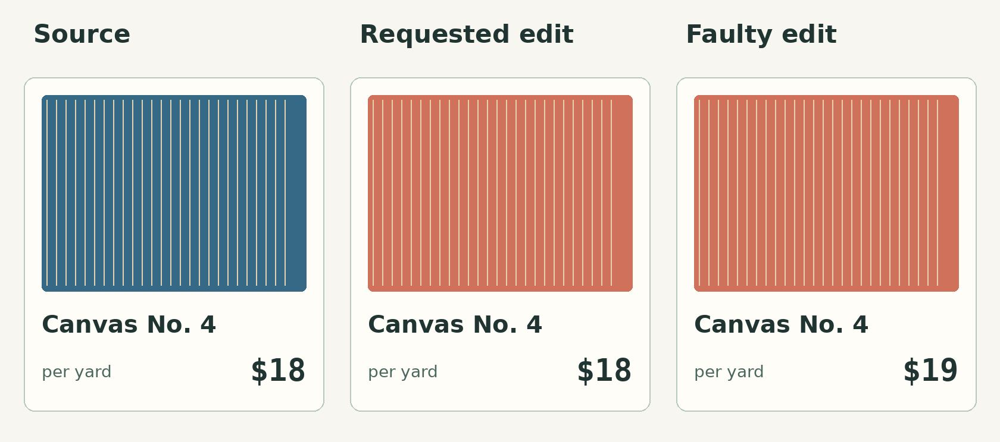

A localized image-edit instruction imposes two constraints. Pixels or semantics inside the target region should change in the requested way. Protected content elsewhere should remain valid. A whole-image similarity score mixes the two: copying the input achieves perfect preservation, while a successful color edit can hide a small but important change to text. GIE-Bench evaluates instruction following and preservation as distinct dimensions. [GIE-Bench](https://machinelearning.apple.com/research/gie-bench)



## Compute the residual outside the edit mask

For registered RGB images, calculate absolute channel differences, set all pixels inside the permitted edit mask to zero, then count positions where the maximum channel difference exceeds a threshold. At a zero threshold this tests exact equality outside the mask. It is appropriate for the lossless, deliberately aligned fixtures below. Save both files beside the script and install Pillow. [Source PNG](/media/catalog-proof/source.png) · [Candidate PNG](/media/catalog-proof/candidate.png)

```python
from PIL import Image, ImageChops, ImageDraw

with Image.open("source.png") as a, Image.open("candidate.png") as b:
    source, candidate = a.convert("RGB"), b.convert("RGB")
assert source.size == candidate.size == (504, 562)
delta = ImageChops.difference(source, candidate)
ImageDraw.Draw(delta).rectangle((28, 26, 478, 366), fill="black")
# A pixel is changed if any of its three channels differs.
red, green, blue = delta.split()
maximum = ImageChops.lighter(ImageChops.lighter(red, green), blue)
changed = sum(maximum.histogram()[1:])
print(changed, maximum.getbbox())
# 459 (445, 472, 472, 512)
```

The output localizes 459 changed pixels outside the swatch to the price label. They occupy about 0.16% of the entire card. An aggregate threshold allowing 1% of the card to change outside the target would accept this candidate. For a price label the semantic requirement is exact value preservation. The location and identity of the change matter far more than its area.

## Choose the metric from the permitted transformation

For a controlled render, exact differences identify every changed byte after decoding. For a photograph, compression, subpixel alignment or slight lighting changes can make that same criterion too sensitive. Register images first when the task preserves camera pose. A tolerance band around an object's boundary can absorb antialiasing. Excluding a wider band lowers false positives but also creates a region in which collateral damage is invisible.

For edits that legitimately change viewpoint, strict pixel correspondence may not exist. Use region-level semantic checks, inspect protected fields against the source record, and evaluate the requested target change separately. OCR agreement on a price is useful evidence, though a poorly rendered digit may still be hard for a person to read. Native-resolution crops make this disagreement inspectable.

I keep an unchanged control, a correct local edit and an edit with one known protected-field mutation in the evaluation set. The unchanged control should fail edit success. The mutated candidate should fail preservation even if its new color is excellent. These controls test what each score actually measures before using it to compare image models.
